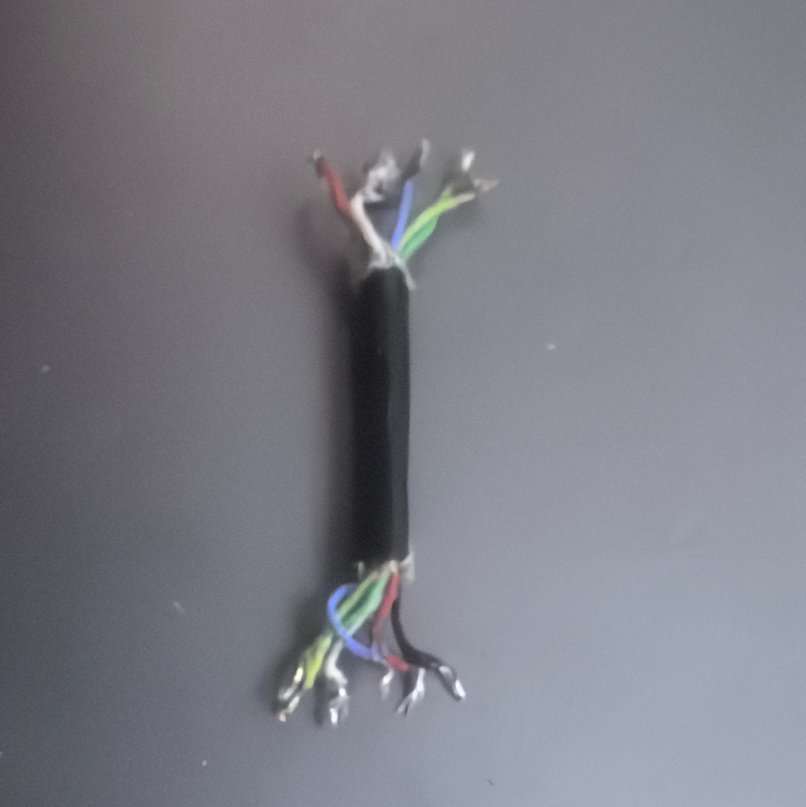
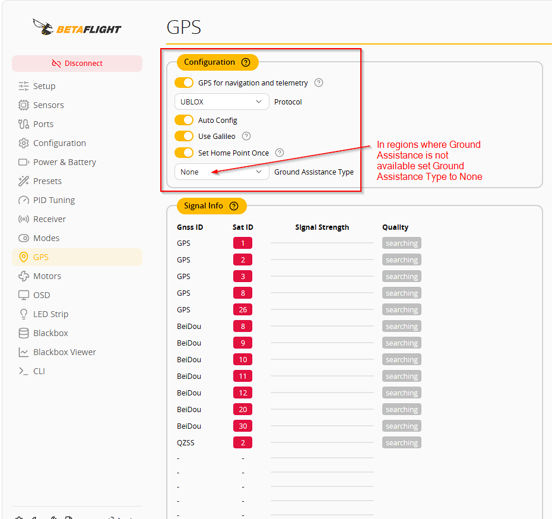
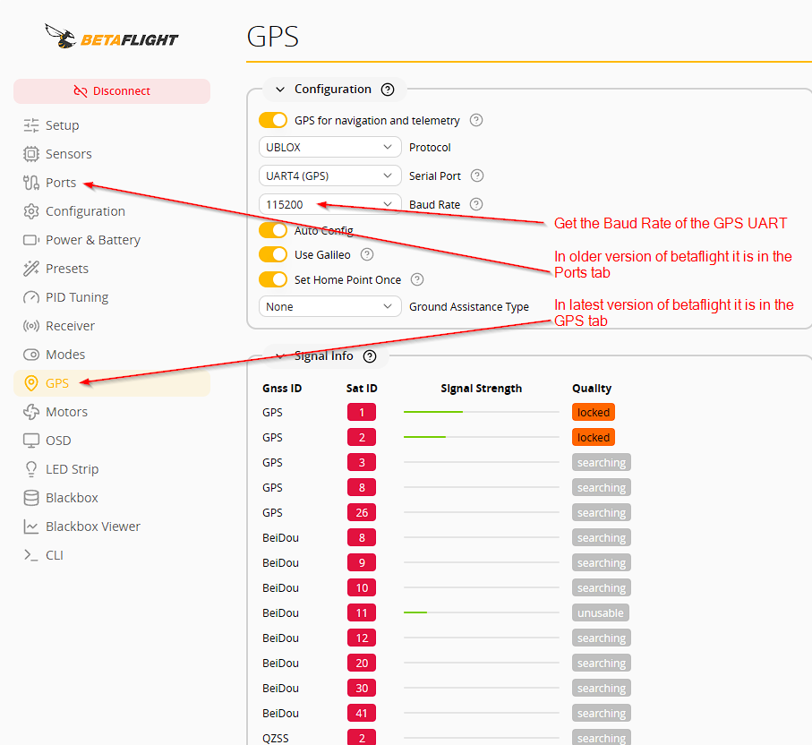
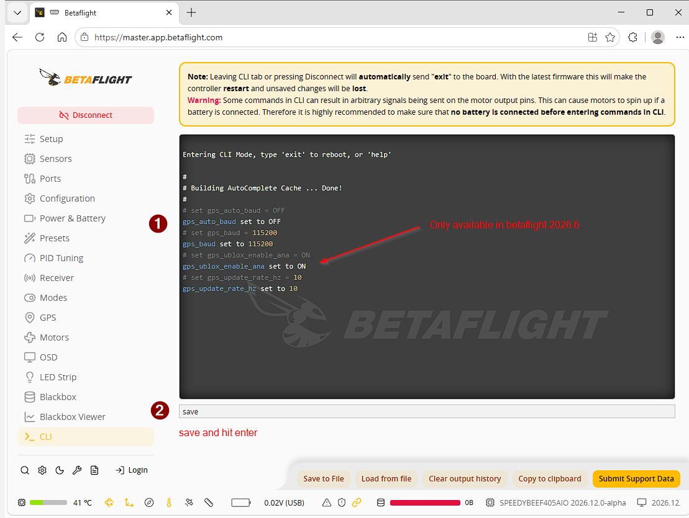
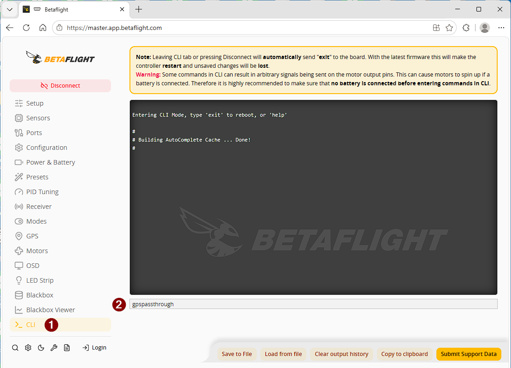
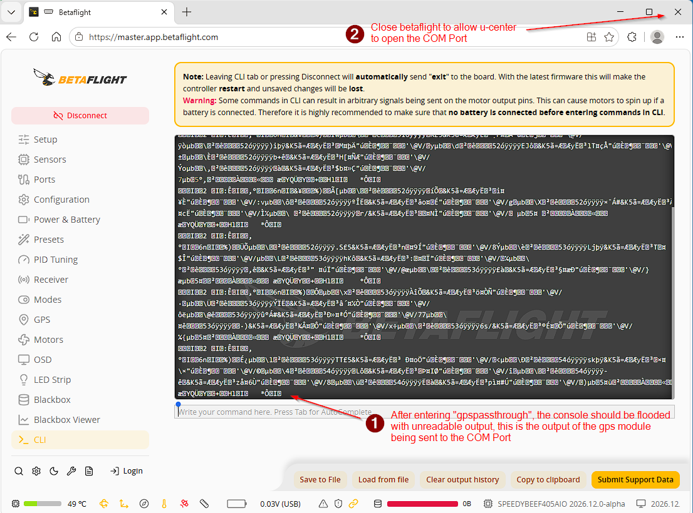
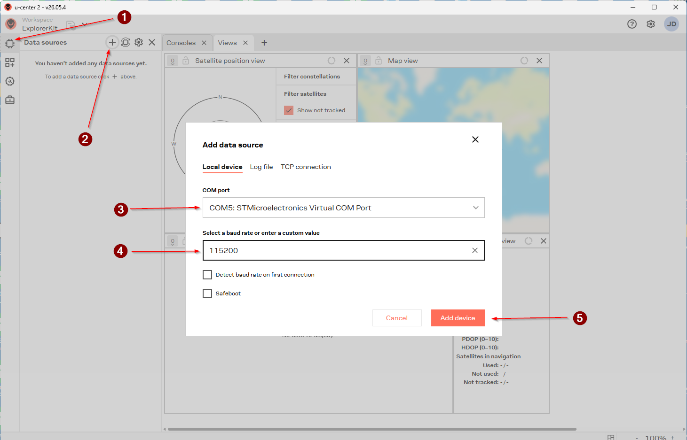
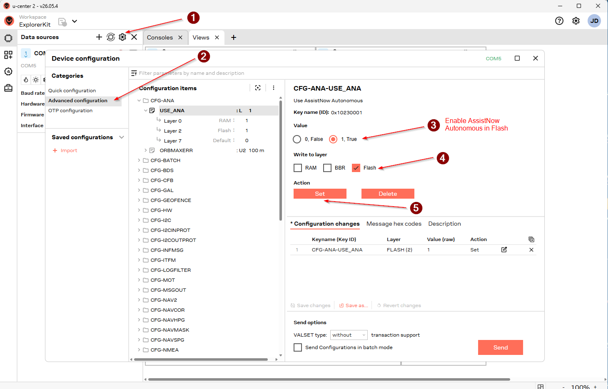
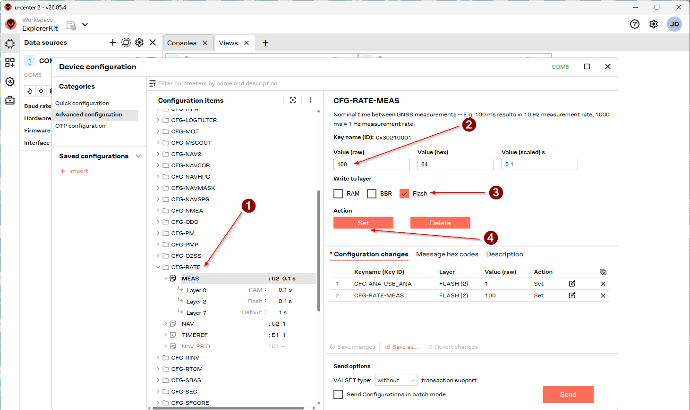
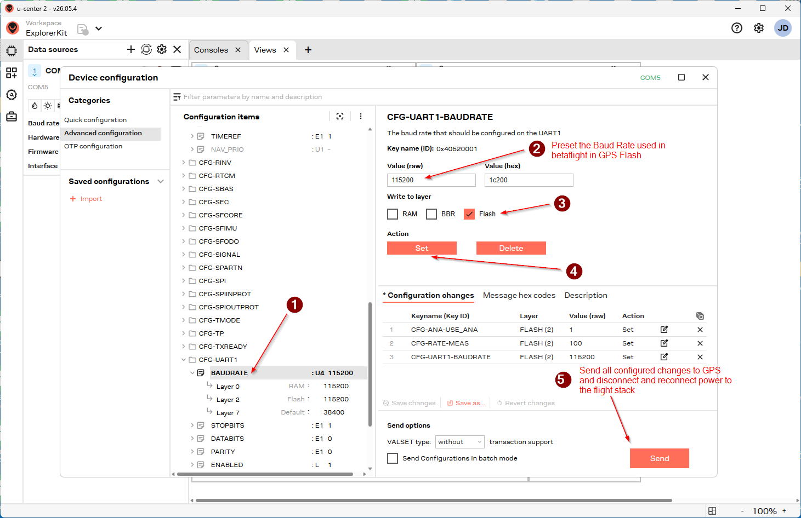

# Betaflight M10 GPS advance configuration guide

## Recommended Cable

The recommended cable is a 6 (with compass) or 4 pin(without compass) shielded cable as it is light small and has a shielding cladding

## Configuring betaflight

## Configuring U-Center

AssistNow Autonomous is a feature of u-blox GNSS receivers that reduces the time-to-first-fix (TTFF) by allowing the receiver to locally predict satellite orbits without requiring external assistance data or an internet connection.

The receiver continuously collects ephemeris data from GNSS satellites during normal operation and stores it in internal memory. Using these observations, the GNSS engine generates AssistNow Autonomous Orbit Predictions (AOP), which estimate the future positions of satellites. When the receiver starts again, it can immediately use these predictions instead of waiting to download ephemeris data from satellites, significantly accelerating the acquisition process.

This approach enables faster startup, improved fix availability, and reduced power consumption, especially in devices that frequently power-cycle or operate without network connectivity.

M10 Constellation vs. Max Update Rate Caps

• 1 Single Constellation (e.g., GPS only): Up to 25 Hz

• 2 Concurrent GNSS (e.g., GPS + Galileo): Up to 20 Hz

• 3 Concurrent GNSS (e.g., GPS + Galileo + GLONASS): Up to 16 Hz

• 4 Concurrent GNSS (GPS + Galileo + GLONASS + BeiDou): Up to 10 Hz

